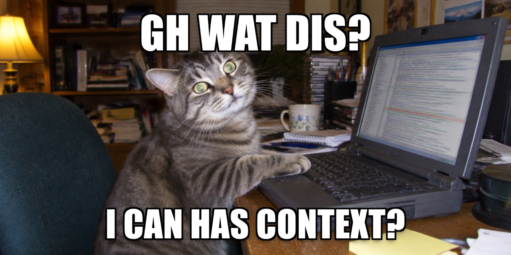

# gh-wat-dis



gh-wat-dis is a set of skills for the coding agent that writes your GitHub issues, pull requests and milestones. Each issue opens with the problem and the solution, shows what changes in the system, and keeps a readable handoff for agents in a collapsed block at the end, so an engineer can read it in two minutes and know what to do.

It ships as one npm package: ten skills, plus small tools the skills call through `npx`. A project adds it as one dev dependency.

## Install

From inside your project, give your coding agent this prompt:

> Let's install `gh-wat-dis` in this project, then tell me how to use it

That is the whole thing.

### If you are the coding agent reading this

You were pointed here by that prompt. Do these, in order:

1. Install the package: `npm install --save-dev gh-wat-dis`, or the project's own package manager, matching whatever lockfile is present. Do this before any `npx` command. No `package.json` in this project: skip this step.
2. Run `npx gh-wat-dis install`. It copies the `wat` skills to `~/.agents/skills` and `~/.claude/skills`, writes `.agents/gh-wat-dis/config.json` for this repository when there is none, then runs every check. Add `--project` to install the skills into this repository only.
3. Read the check lines. Each is `ok`, `FIX` or `off`. Under every `FIX` line an arrow names the one thing to do: do it. An `off` line is an optional feature, and its arrow says how to turn it on.
4. If the `GitHub sign-in` line says `FIX`, the sign-in needs a person and a browser. Ask the human to run `npx gh-wat-dis doctor` in their own terminal: it offers to sign in, then checks again. Do not run the sign-in for them.
5. The GitHub MCP server is optional: the skills read through `gh` without it. If the human wants it, ask whether to set it up for every repository or only this one, then run `npx gh-wat-dis mcp --apply --scope user` (or `--scope project`). Never ask for a token in chat. Never write a token into a file.
6. Review `.agents/gh-wat-dis/config.json` with the human: the `wat-setup` skill has the questions to ask. Then commit it.
7. Tell the human to restart the harness so the skills load.
8. Then read "Use it" below and explain it to them in your own words. The prompt asked for it.

**npm install-script warning.** npm 11 can print `npm warn install-scripts` for `@ast-grep/lang-rust@0.0.7 (postinstall: node postinstall.js)`. The package includes prebuilt Rust parsers for macOS ARM64/X64, Linux ARM64/X64 and Windows X64. On a platform where that parser loads, the postinstall script is not needed: it finds the prebuilt parser and returns. Run `npx gh-wat-dis doctor --offline`; `ok Rust analysis` confirms it works without approving the script.

If no compatible parser is available, `doctor` reports `FIX Rust analysis` instead. Reinstalling alone cannot supply a prebuilt parser for an unsupported platform. Report the platform and that diagnostic; do not approve scripts just to silence the warning. The script's fallback builds a parser with `tree-sitter-cli`, which is not supplied by gh-wat-dis. Linux musl compatibility has not been verified.

Do not edit the installed skill directories. `install` owns them and will not overwrite your edits without `--force`.

If a command hangs or runs out of memory, your harness is running it in a sandbox that blocks npm. Read your harness's sandbox documentation (for Codex: https://developers.openai.com/codex/security) and tell the human what it needs.

## What you need

| Need | Why |
|---|---|
| Node 24 or later (or Bun, or Deno) | Runs `npx gh-wat-dis` |
| GitHub CLI 2.99 or later, signed in | Every write goes through `gh`. `--attach` uploads diagrams. |
| GitHub MCP server (optional) | Reads and search. Skills fall back to `gh` without it. |
| cccc (optional) | Complexity facts for `impact`. `npx gh-wat-dis doctor --tools install` fetches the pinned release and checks its sha256 and build attestation. |

## Use it

Ask in plain words. The skills trigger on the task.

| You say | Skill |
|---|---|
| "File an issue for the duplicate charge bug" | `wat-issue` |
| "Open a PR for this branch" | `wat-pr` |
| "Plan the v1.4 milestone" / "Where are we on v1.4?" | `wat-milestone` |
| "Triage the new issues" | `wat-triage` |
| "Run a backlog cleanup" | `wat-maintain` |
| "What does this change affect?" / "Map the architecture" | `wat-architecture` |
| "Draw the container diagram for checkout" | `wat-diagram` |
| "Explain #56" / "Give me a deep dive on this PR" | `wat-dis` |
| "Set up gh-wat-dis" | `wat-setup` |
| "Migrate this repo and its open issues to gh-wat-dis" | `wat-migrate` |

Every issue and PR:

- opens with the problem and how it is solved, in a plain sentence
- states what changes in the system, with a diagram whenever code changes, unless the facts show it would add nothing
- takes its claims about code from tools, each fact labeled with its source
- lists risks, evidence and what is still unknown
- keeps a self-contained handoff for agents in one collapsed block at the end, as readable text you can copy into any agent

The agent shows you the draft before it posts.

## Repo policy

`.agents/gh-wat-dis/config.json` settles whether agents use these skills in a repository, and holds its defaults.

| `policy.use` | Agents |
|---|---|
| `always` | Use the skills without asking |
| `ask` | Ask once per session |
| `never` | Do not use them |
| no config file | Ask before the first use, and offer `install` |

The file also holds the issue types, the labels (surfaces, priorities, sizes), milestone naming and capacity, when triage calls an issue or PR stale, and the architecture map that gives every issue and PR the same names for the same parts of the system.

## Tools

Each tool does one thing. Data tools write JSON on stdout so they chain. Presentation tools such as `blast`, `legend` and `dis` can print text; `dis --json` prints a structured result with artifact paths. `-` or piped stdin stands in for a file.

| Tool | Does |
|---|---|
| `impact` | Collects facts on what a change touches and reaches. TypeScript, JavaScript and Rust get symbol-level analysis. With cccc installed it adds each function whose complexity the change moved. |
| `reach <path\|symbol>` | Lists who depends on a file or symbol. No diff needed. |
| `owners <path>` | Resolves CODEOWNERS. |
| `elements` | Lists architecture elements and the files they map. |
| `issues` | Lists open issues with type, surfaces, milestone and what each one is missing. |
| `survey` | Reports what a repository with history holds before a migration: issues by what they lack, labels outside the plan, open milestones. |
| `audit` | Runs the maintenance checks that can be counted and prints one finding for each item: stale issues and PRs, missing fields, milestones, orphan PRs, done but open, labels, blocked chains. |
| `related` | Finds issues and PRs that share signals with a draft. |
| `links` | Shows what a PR will close on merge and what it only mentions. |
| `milestone` | Rates a milestone with no dates and prints every measured signal behind the rating, with the numbers for a status report: counts, what is in review, what is blocked. |
| `relations`, `relate` | Reads and sets GitHub's own relations: parent, sub-issue, blocked by, blocking. A new parent replaces the old one. |
| `labels` | Plans and creates the labels: `agents`, one for each product surface, priority (`critical` to `nit`), size (`s` to `xl`), and the type labels on a user repository. |
| `graph <op>` | Builds and reshapes a diagram spec: `from-facts`, `from-config`, `focus`, `collapse`, `drop`, `merge`, `diff`, `set`, `rename`, `split`, `stats`, `ids`. |
| `diagram` | Lints a C4 diagram spec and renders an SVG that fits GitHub's width. `--png` adds a PNG for the agent to look at. |
| `legend` | Prints a diagram's relationships as a Markdown table. |
| `blast` | Formats impact facts as a Markdown section: what a change reaches outside its diff, with file links. |
| `dis <reference>` | Explains an issue or PR from its thread; `--full` measures a PR and writes its diagram, Markdown and cache stamp. `--json` prints paths and explanation as JSON. |
| `lint` | Backstop: catches what GitHub would break in a body. |
| `install`, `uninstall`, `init`, `mcp`, `doctor` | Set up and check. `doctor --tools install` fetches the optional cccc binary and verifies it. |
| `help` | Lists every tool with what it does and whether it writes. `help --json` prints the list for an agent. |

`npx gh-wat-dis dis 56` gives a quick thread explanation without fetching git objects. Use `dis owner/repo#56` or an issue/PR URL for another repository. `dis 56 --full` runs the full pass directly. It caches artifacts under `.agents/gh-wat-dis/dis/<owner>/<repo>/<number>/`; matching source stamps reuse a full result, while updates report drift and rebuild it. `install` adds the cache ignore rule and `doctor` checks it. An already formatted body is preserved with its attached diagram; other bodies receive a sourced summary, and the `wat-dis` skill explains the reasoning in chat.

`npx gh-wat-dis help` is the full list. `npx gh-wat-dis <tool> --help` gives one tool's options.

```bash
npx gh-wat-dis impact \
  | npx gh-wat-dis graph from-facts \
  | npx gh-wat-dis graph collapse --to-type container \
  | npx gh-wat-dis diagram -o change.svg
```

Facts carry a label that names their source: `exact` (read from git or a file), `resolved` (an AST parse resolved it), `measured` (a count over history or the graph), `heuristic` (inferred from a path or name). The tools report. They do not score or give verdicts.

## Scope

gh-wat-dis reports what a change does and leaves the verdict to the reviewer. Coding style, test policy and branch rules come from your repository. gh-wat-dis decides how to communicate the work.

## When something is wrong

Run `npx gh-wat-dis doctor`.

| Symptom | Cause | Fix |
|---|---|---|
| `FIX GitHub CLI` | GitHub CLI missing, or older than 2.99 | `brew upgrade gh`, or https://cli.github.com |
| `FIX GitHub sign-in` | Not signed in, or the saved sign-in expired | Run `npx gh-wat-dis doctor` in your terminal and accept the sign-in |
| `FIX skills` | Not installed, out of date, or a directory `install` does not own | `npx gh-wat-dis install` (`--force` to replace) |
| Skills do not trigger | Harness not restarted | Restart it |
| A command hangs, then "heap out of memory" | The harness's sandbox blocks npm | See your harness's sandbox docs ([Codex](https://developers.openai.com/codex/security)) |
| Image shows as a broken link | The file was not attached | Post with `gh ... --attach <file>` and check the body has an `https://` image URL |

## Update and remove

```bash
npx gh-wat-dis@latest install
```

```bash
npx gh-wat-dis uninstall
```

## Credits

The writing style adapts [attention-control](https://github.com/aaddrick/attention-control) and [no-ai-slop](https://github.com/petergyang/no-ai-slop). Diagrams follow the [C4 model](https://c4model.com) and are laid out by [elkjs](https://github.com/kieler/elkjs). Code facts come from [ast-grep](https://ast-grep.github.io). See `NOTICE.md`.

MIT licensed.
